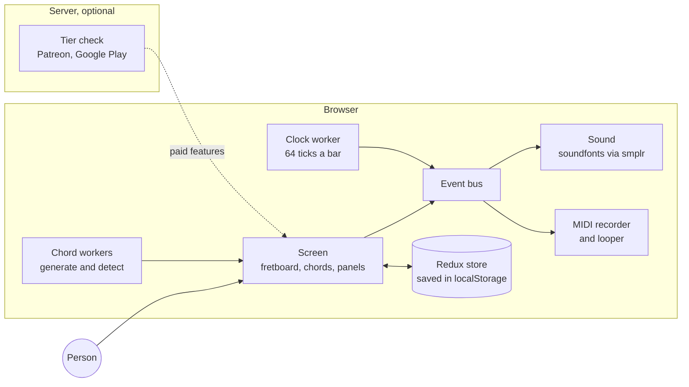

# How Guitar Upscale works

Guitar Upscale is a guitar you play in the browser. The person taps notes on a fretboard, plays chords from a scale, records loops and edits them as MIDI.

| Page                               | Read it to                                                |
| ---------------------------------- | --------------------------------------------------------- |
| [README.md](README.md)             | get the big picture in a few minutes                      |
| [features.md](features.md)         | learn what each part of the screen does                   |
| [user-flows.md](user-flows.md)     | follow a person through common tasks                      |
| [architecture.md](architecture.md) | find your way around the code                             |
| [design.md](design.md)             | build screens with the shared colors and components       |
| [chords.md](chords.md)             | see how chord shapes and fingerings are built, in Russian |
| [scales.md](scales.md)             | see how scales are listed and detected, in Russian        |

## The app in one picture

The browser does the real work. The server only checks who the person is and what they paid for, and the GitHub Pages copy runs with no server.

## What is on the screen

| Part              | What the person does with it                                                   |
| ----------------- | ------------------------------------------------------------------------------ |
| **Fretboard**     | taps notes, sees the scale and the chord shapes                                |
| **Control panel** | picks the scale, tuning and capo, opens settings and the tools                 |
| **Chords**        | taps a chord of the key to play it, holds it to strum. "All" shows every chord |
| **Play panel**    | plays the scale or a song, sets tempo and volume, records MIDI, downloads it   |
| **Looper**        | records short loops on separate channels and stacks them                       |
| **Piano roll**    | edits a melody or a loop note by note                                          |

[features.md](features.md) covers each part in detail.

## Who gets what

The app has a free tier and two paid ones. Sign-in is off by default, and then each visitor gets Composer.

| Tier         | Adds                                                                                                 |
| ------------ | ---------------------------------------------------------------------------------------------------- |
| **Free**     | fretboard, scales, tunings, basic chords, strumming, scale playback, piano roll                      |
| **Explorer** | song examples, more chord types, instrument choice, reverb, playback type, chord and scale detection |
| **Composer** | MIDI recording, looper, song upload (Guitar Pro and MIDI), skins, recording options                  |

A person pays through Patreon on the web or Google Play in the Android app.

## Two ways it runs

- **GitHub Pages** a static export with no server. Sign-in is off, so each visitor gets Composer.
- **Server build** Next.js with API routes. Sign-in turns on with `NEXT_PUBLIC_AUTH_ENABLED=true`.

The Android app wraps the same PWA with Bubblewrap.

## Ideas that hold the code together

- **One clock** a Web Worker ticks 64 times a bar. Playback, strumming, the metronome and the looper wait on those ticks.
- **One event bus** each note and chord goes through RxJS subjects. Sound, fret animation and both recorders listen to them.
- **One note format** `EventsByTick` holds songs, recordings, loops and piano roll edits alike.
- **Workers for heavy maths** chord shapes and chord lookup run off the main thread.
- **Paid code loads late** the server picks the paid components, and Next.js loads them on demand.

[architecture.md](architecture.md) explains each idea with the files behind it.
