# Architecture

Guitar Upscale is one Next.js page. The server renders it once and picks the paid components. After that the browser runs the app alone.

- **React components** in [src/app/components](../src/app/components) draw the screen and take input.
- **Engine modules** in [src/app/engine](../src/app/engine) play sound, keep time and record. They are plain TypeScript, outside React.
- **Redux store** in [src/app/store](../src/app/store) holds settings and UI state, saved to `localStorage`.
- **Server code** in [src/lib](../src/lib) and [src/pages/api](../src/pages/api) handles sign-in and purchases.

## The layers

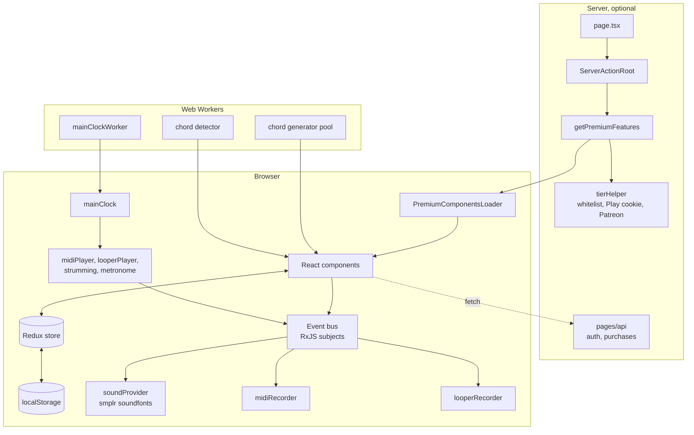

## Where the code sits

| Folder                                                              | What it holds                                                                                                         |
| ------------------------------------------------------------------- | --------------------------------------------------------------------------------------------------------------------- |
| [src/app/components](../src/app/components)                         | UI, one folder per screen part: `fret`, `chords`, `strumming`, `playPanel`, `looper`, `pianoRoll`, `settings`, `auth` |
| [src/app/components/uiFramework](../src/app/components/uiFramework) | shared MUI wrappers: buttons, dialogs, sliders, selectors                                                             |
| [src/app/context](../src/app/context)                               | React contexts: theme, tier, scale, piano roll                                                                        |
| [src/app/store](../src/app/store)                                   | Redux slices and the persisted store                                                                                  |
| [src/app/engine](../src/app/engine)                                 | sound, clock, event bus, players, recorders, chord and scale maths                                                    |
| [src/app/data](../src/app/data)                                     | static data: scales, tunings, instruments, chord types, patterns, songs                                               |
| [src/app/hooks](../src/app/hooks)                                   | hooks that link React to the engine: `usePlay`, `useStrumming`, auth checks                                           |
| [src/app/helpers](../src/app/helpers)                               | small helpers: canvas drawing, device checks, debounce, a trie                                                        |
| [src/lib](../src/lib)                                               | server code: NextAuth, tiers, Google Play billing                                                                     |
| [src/pages/api](../src/pages/api)                                   | API routes. The GitHub Pages build deletes this folder                                                                |

## Start-up

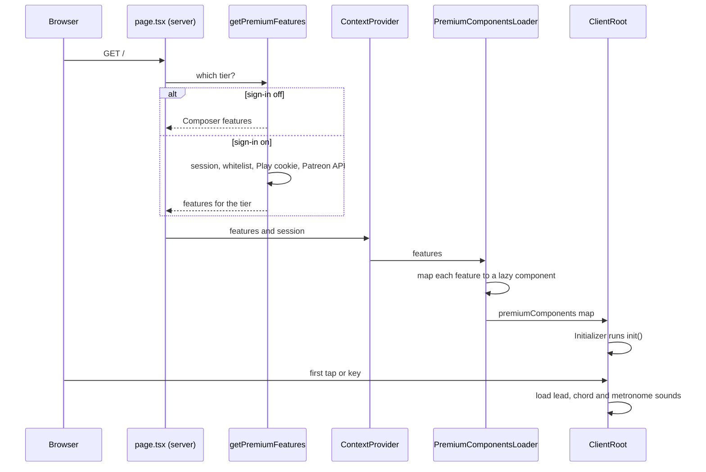

- **Server step** [page.tsx](../src/app/page.tsx) and [ServerActionRoot.tsx](../src/app/components/ServerActionRoot.tsx) fetch the tier and session.
- **Paid parts** [PremiumComponentsLoader.tsx](../src/app/components/PremiumComponentsLoader.tsx) turns each enabled feature into a `next/dynamic` component. The code for a locked feature stays off the page.
- **Client root** [ClientRoot.tsx](../src/app/components/ClientRoot.tsx) lays out the screen. A slot with no paid component shows a locked button or stays empty.
- **First touch** [Initializer.tsx](../src/app/components/Initializer.tsx) waits for a tap, since browsers block audio before a gesture.

## Component tree

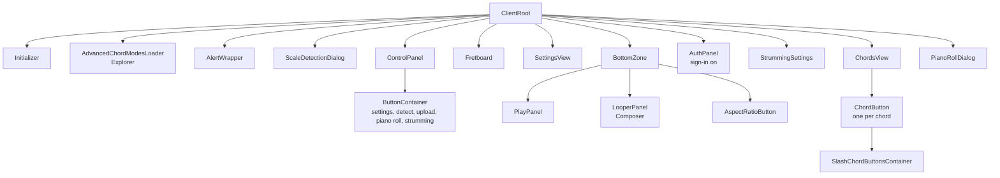

## Context providers

[ContextProvider.tsx](../src/app/context/ContextProvider.tsx) wraps the app in this order, outermost first.

| Order | Provider                          | Gives                                            |
| ----- | --------------------------------- | ------------------------------------------------ |
| 1     | `SessionProvider`                 | the NextAuth session. Only with sign-in on       |
| 2     | Redux `Provider`                  | the store                                        |
| 3     | `MuiThemeProvider`                | light or dark MUI theme                          |
| 4     | `DigitalGoodsServiceInfoProvider` | whether the Google Play Digital Goods API exists |
| 5     | `PremiumFeaturesProvider`         | the feature flags, copied into `authSlice`       |
| 6     | `PersistGate`                     | holds rendering until `localStorage` loads       |

[PianoRollDialog.tsx](../src/app/components/pianoRoll/PianoRollDialog.tsx) adds its own providers: `ScaleProvider` and `BaseNoteProvider` for the scale and root note, then `PianoRollProvider` and `PianoRollViewProvider` for tracks and view.

## State

### Redux slices

| Slice                                                | Holds                                                                                                |
| ---------------------------------------------------- | ---------------------------------------------------------------------------------------------------- |
| [settingsSlice](../src/app/store/settingsSlice.ts)   | scale, tuning, capo, instruments, tempo, volumes, chord and strumming options, play and record flags |
| [uiSlice](../src/app/store/uiSlice.ts)               | theme, display modes, open panels, alerts, suggested scales, fretboard size                          |
| [pianoRollSlice](../src/app/store/pianoRollSlice.ts) | piano roll tool, snap, zoom, follow playhead                                                         |
| [authSlice](../src/app/store/authSlice.ts)           | sign-in state and tier                                                                               |

- **Saving** `redux-persist` writes each slice to `localStorage` under its own key, such as `persist:settings`. The `blacklist` of a slice in [store.ts](../src/app/store/store.ts) keeps short-lived fields such as alerts and play flags out.
- **Versions** [store.ts](../src/app/store/store.ts) has a `VERSION`. `createMigrate` wipes a slice saved with an older version, so a breaking change needs a bump.

### Values the engine reads

Engine code runs outside React and can't call hooks. So [settingsSlice.ts](../src/app/store/settingsSlice.ts) keeps a module variable next to each setting the engine needs, such as `tempoBpmValue` and `isPlayingValue`.

- **Reducers** set the variable together with the state field.
- **Rule** the engine reads the `...Value` variable. React reads the store through `useSettingsSelector`.

### State outside Redux

Some data is too big or too mutable for Redux. It lives in modules, and a Redux counter tells React when it changed.

| Data                  | Module                                                                       | React learns about changes from        |
| --------------------- | ---------------------------------------------------------------------------- | -------------------------------------- |
| loaded melody         | [pianoRollState.ts](../src/app/engine/pianoRoll/pianoRollState.ts)           | `showReplayTrigger`                    |
| looper channels       | [looper.ts](../src/app/engine/looper/looper.ts)                              | `looperStateUpdateTrigger`             |
| custom strum patterns | [strummingPatternsStorage.ts](../src/app/engine/strummingPatternsStorage.ts) | `localStorage` key `strummingPatterns` |
| chord shapes          | [chordNotesByName.ts](../src/app/engine/chords/chordNotesByName.ts)          | `chordsAreLoading`                     |

A change to scale, tuning or capo bumps `guitarSettingsUpdateCount`. Playback, the looper and the chords reset on that bump.

## The clock

A Web Worker ticks so that a busy main thread can't slow the beat.

- **Grid** 4/4 time, 16 ticks a beat, 64 ticks a bar. See [clockConstants.ts](../src/app/data/clockConstants.ts).
- **Worker** [mainClockWorker.ts](../src/app/engine/clock/mainClockWorker.ts) posts a tick on a `setInterval` set from the tempo.
- **Waiting** [mainClock.ts](../src/app/engine/clock/mainClock.ts) gives promises: `waitForNextBar`, `waitForNextBeat`, `waitForNextTick` and finer steps.
- **On demand** `tryToggleInterval` starts the clock for playback, strumming, recording or the metronome. It stops once none of them runs.
- **Ticks out** each tick also goes to `MetronomeEventBus`, which the metronome and the piano roll playhead use.

## Events: from a tap to a sound

Notes and chords go through RxJS subjects in [eventBus.ts](../src/app/engine/eventBus.ts). The sender doesn't know who listens.

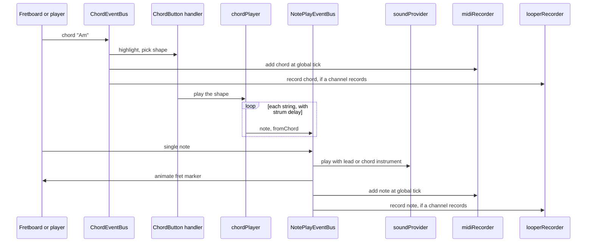

- **Two subjects** `ChordEventBus` carries chord names. `NotePlayEventBus` carries single notes.
- **Lookup maps** `NoteToFretMarkerEventMap` and `ChordToChordButtonEventMap` link a note or chord to the component that draws it.
- **Tracks** notes default to track 0 and chord notes to track 1. Each track keeps its instrument.

## One note format: `EventsByTick`

[eventsByTick.ts](../src/app/engine/eventsByTick.ts) stores notes and chords by clock tick. Songs, recordings, loops and piano roll edits share it.

- **Lookups** a map by tick, a map by event id and an AVL tree for the next or previous tick.
- **Events** a note or a chord, with an id and an optional length in ticks. No length means one beat.

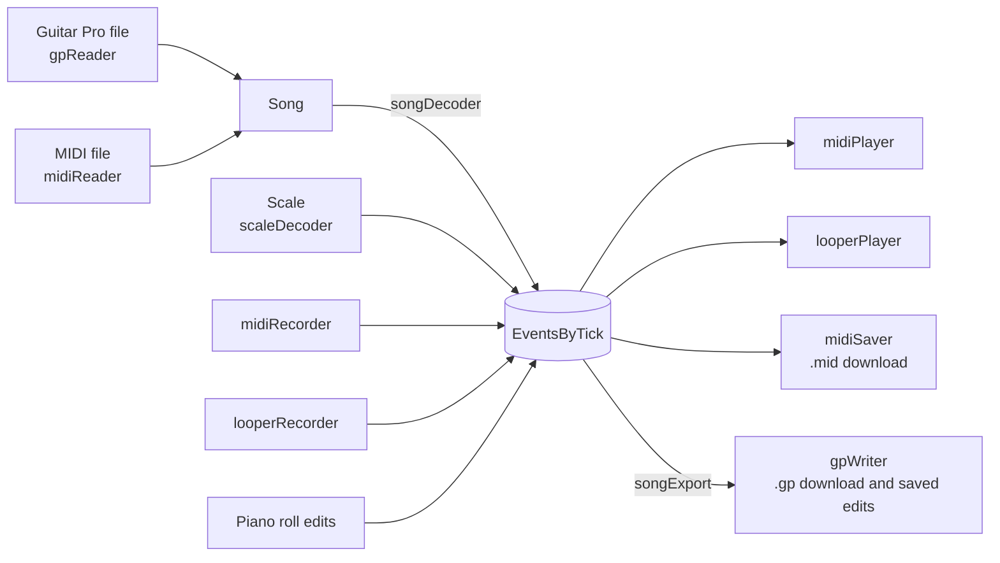

## Playback

[midiPlayer.ts](../src/app/engine/midiPlayer.ts) walks an `EventsByTick` in time with the clock and sends each event to the bus.

- **Entry** `playMidi` stores the data as the loaded melody, so the piano roll and download button see it.
- **Pause** the player awaits `waitForPauseToBeReleased`. Previous and next release one step and pause again.
- **Choice of data** [usePlay.ts](../src/app/hooks/usePlay.ts) picks what Play plays: a song example, the scale, or a replay of the loaded melody.
- **Songs** [songLibrary.ts](../src/app/engine/songs/songLibrary.ts) joins the Guitar Pro files listed in `public/songs/index.json` with the songs kept in the browser. The index already names each song's scale. [gpReader.ts](../src/app/engine/songs/gpReader.ts) and [midiReader.ts](../src/app/engine/songs/midiReader.ts) turn a file into a [`Song`](../src/app/data/song.ts): tab notes, pitch notes and chords per track.
- **Chords** only a track named `Chords` gives chords, so chords stay apart from the melody. [songDecoder.ts](../src/app/engine/decoders/songDecoder.ts) plays them by name and moves the song to the key in the settings.
- **Edits and downloads** [songExport.ts](../src/app/engine/songs/songExport.ts) turns the loaded events back into a `Song` and [gpWriter.ts](../src/app/engine/songs/gpWriter.ts) writes it as `.gp`. A piano roll edit fires `pianoRollEdits$`, and [songLibrary.ts](../src/app/engine/songs/songLibrary.ts) saves the song it came from.

## Recording

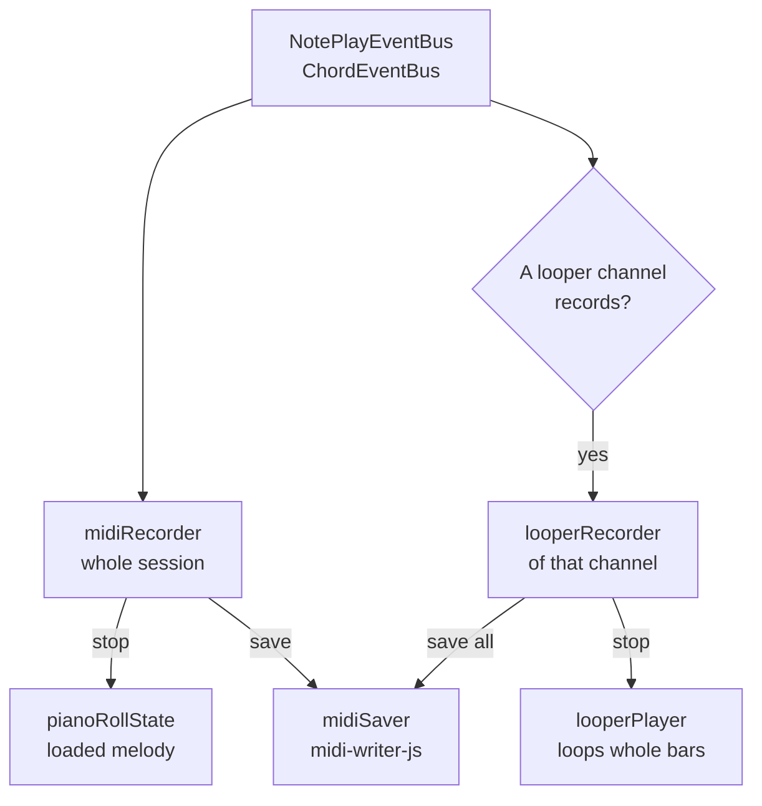

- **MIDI recorder** [midiRecorder.ts](../src/app/engine/midiRecorder/midiRecorder.ts) writes events at the global tick while recording is on. The download button reuses it to save the loaded melody.
- **Looper** [looper.ts](../src/app/engine/looper/looper.ts) keeps 1 to 8 channels. One records at a time.
- **Loop timing** [looperRecorder.ts](../src/app/engine/looper/looperRecorder.ts) starts a loop at the bar of the first event. [looperPlayer.ts](../src/app/engine/looper/looperPlayer.ts) rounds the length to whole bars.
- **Events from playback** events that a loop plays carry `looperChannel`, so the looper recorder skips them. The MIDI recorder keeps them, so a MIDI take includes the playing loops.

## Strumming

[useStrumming.ts](../src/app/hooks/useStrumming.ts) runs inside each `ChordButton`. Shared state across buttons sits in [strummingState.ts](../src/app/engine/strummingState.ts).

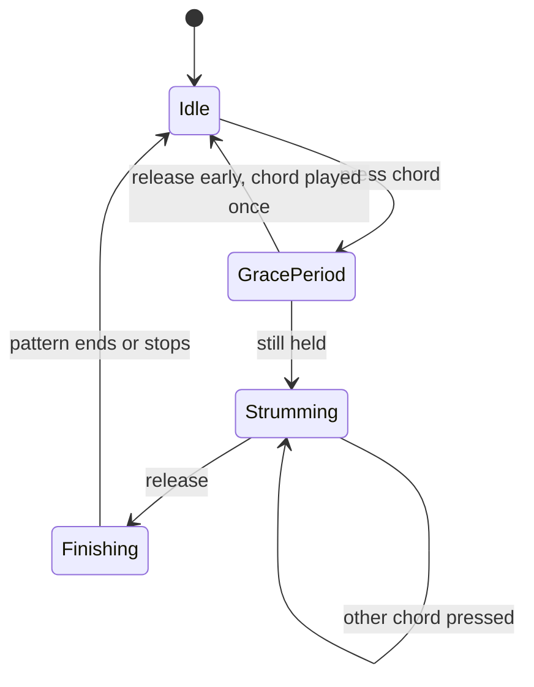

- **Alignment** a new pattern skips steps so that it lands on the next bar, half bar, beat or half beat. [strummingTiming.ts](../src/app/engine/strummingTiming.ts) counts the steps.
- **Release** stops the pattern, or lets it finish when "Wait for pattern to finish" is on.
- **Switching** with "Chord switching amidst pattern" on, the running pattern takes the new chord.

## Chords and scales

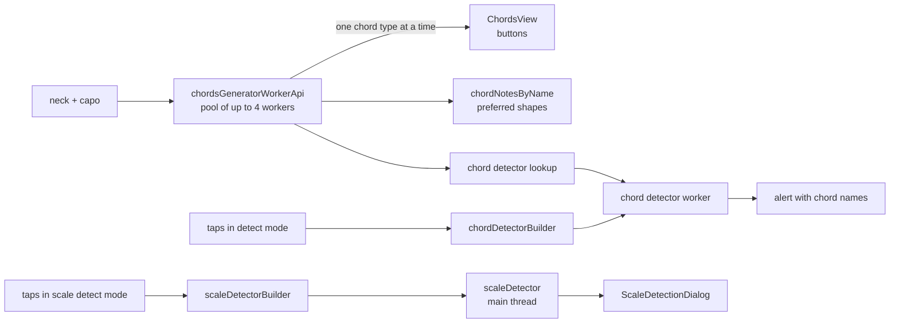

- **Generator** [chordsGeneratorWorkerApi.ts](../src/app/engine/chords/chordsGeneratorWorkerApi.ts) starts its workers at load and keeps them. A settings change stops a running job and starts again.
- **Order** chord types finish out of order across workers. The API hands them on in list order.
- **Chord types** [chordModes.ts](../src/app/data/chordModes.ts) has major and minor for free. [AdvancedChordModesLoader.tsx](../src/app/components/AdvancedChordModesLoader.tsx) adds the rest for Explorer.
- **Shape choice** [chordPlayer.ts](../src/app/engine/chords/chordPlayer.ts) picks a shape per the chord play mode: round robin, preferred, random and more.
- **Detection** both detectors wait 200 ms after the last tap before they search.

## Piano roll

The piano roll edits an `EventsByTick` in place, through commands that undo.

- **Provider** [PianoRollProvider.tsx](../src/app/context/PianoRollProvider.tsx) lists the tracks (the melody plus each recorded loop), the selection and undo state.
- **Edits** [operations.ts](../src/app/engine/pianoRoll/operations.ts) turns a gesture into an `EditCommand`. [editHistory.ts](../src/app/engine/pianoRoll/editHistory.ts) keeps one undo stack per track.
- **Drawing** [PianoRollCanvas.tsx](../src/app/components/pianoRoll/PianoRollCanvas.tsx) draws with Konva. [geometry.ts](../src/app/engine/pianoRoll/geometry.ts) maps ticks and pitches to pixels.
- **Input** [useNoteAreaInteraction.ts](../src/app/components/pianoRoll/useNoteAreaInteraction.ts) handles mouse and touch. [usePianoRollShortcuts.ts](../src/app/components/pianoRoll/usePianoRollShortcuts.ts) handles keys.
- **Playhead** the melody uses `playheadTick$` from [playhead.ts](../src/app/engine/pianoRoll/playhead.ts). A loop computes its playhead from the clock.
- **Loop range** `loopRange$` in [playhead.ts](../src/app/engine/pianoRoll/playhead.ts) holds the melody range picked on the ruler. [midiPlayer.ts](../src/app/engine/midiPlayer.ts) jumps back to its start at its end.

## Sound

[soundHelper.ts](../src/app/engine/sound/soundHelper.ts) loads instruments with [smplr](https://github.com/danigb/smplr) and keeps them in a cache.

- **Soundfonts** General MIDI instruments from [instruments.ts](../src/app/data/instruments.ts). `sampled_piano` uses smplr's `SplendidGrandPiano`.
- **One context** an `AudioContext` created on first use and resumed when the browser suspends it.
- **Reverb** an smplr effect, added on desktop only.
- **Metronome** its own sound in [metronomeProvider.ts](../src/app/engine/sound/metronomeProvider.ts).

## Tiers and paid features

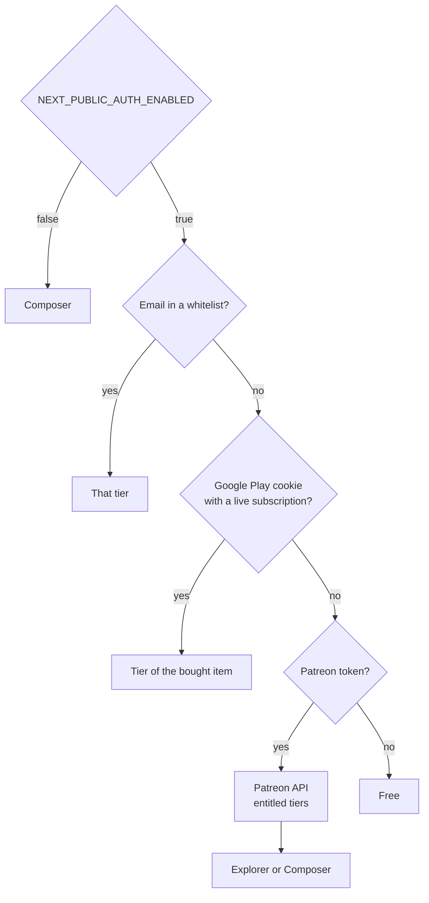

- **Feature lists** [premiumFeatures.ts](../src/lib/premiumFeatures.ts) defines what Explorer and Composer turn on.
- **Tier lookup** [tierHelper.ts](../src/lib/tierHelper.ts) runs the checks above on each page load.
- **Locked buttons** `Disabled...Button` components in [settings/buttons](../src/app/components/settings/buttons) wrap [NoPremiumButton.tsx](../src/app/components/settings/buttons/NoPremiumButton.tsx). A tap shows which plan unlocks the feature.

### Google Play purchase

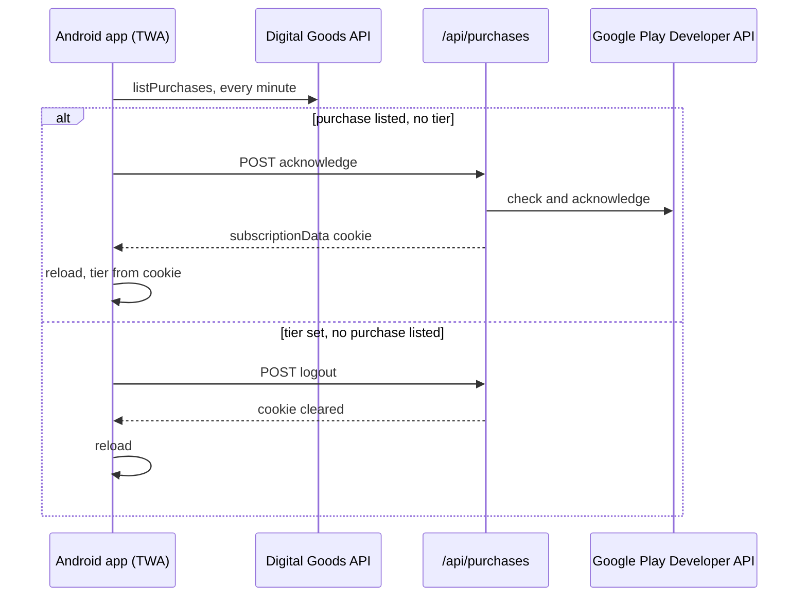

| Route                             | Does                                                              |
| --------------------------------- | ----------------------------------------------------------------- |
| `POST /api/purchases/acknowledge` | checks a new purchase, acknowledges it, sets the cookie           |
| `POST /api/purchases/change`      | upgrade or downgrade. Revokes the old plan, or defers the new one |
| `POST /api/purchases/cancel`      | refunds inside the grace period, else cancels at the end date     |
| `GET /api/purchases/get`          | subscription dates and how it can be cancelled                    |
| `POST /api/purchases/logout`      | clears the cookie                                                 |
| `/api/auth/[...nextauth]`         | Patreon sign-in through NextAuth                                  |

The Google Play code is in [hooks/useGooglePlayAuth.ts](../src/app/hooks/useGooglePlayAuth.ts), [lib/purchases.ts](../src/lib/purchases.ts) and [lib/subscriptionHelper.ts](../src/lib/subscriptionHelper.ts).

## Build and deploy

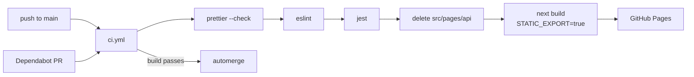

- **Static export** [next.config.mjs](../next.config.mjs) sets `output: "export"` when `STATIC_EXPORT=true`. `NEXT_PUBLIC_BASE_PATH` sets the sub path.
- **Server build** a plain `next build` keeps the API routes for sign-in.
- **PWA** [sw.js](../public/sw.js) caches responses network first. [manifest.json](../public/manifest.json) asks for fullscreen landscape.
- **Tests** Jest covers `EventsByTick`, the Guitar Pro and MIDI song readers, song transposing, the looper player, piano roll edits and geometry, strum timing, chord button and fretboard layout, the trie and Google Play subscription parsing.

## Where to start a change

| To change                | Start in                                                                                                                                                 |
| ------------------------ | -------------------------------------------------------------------------------------------------------------------------------------------------------- |
| a scale or a scale group | [scales.ts](../src/app/data/scales.ts)                                                                                                                   |
| a chord type             | [chordModes.ts](../src/app/data/chordModes.ts)                                                                                                           |
| a built-in strum pattern | [strummingPatterns.ts](../src/app/data/strummingPatterns.ts)                                                                                             |
| a built-in song          | a `.gp` file in [public/songs/](../public/songs/), then `pnpm songs:index`. It picks the scale with [songScale.ts](../src/app/engine/songs/songScale.ts) |
| what a tier unlocks      | [premiumFeatures.ts](../src/lib/premiumFeatures.ts) and [PremiumComponentsLoader.tsx](../src/app/components/PremiumComponentsLoader.tsx)                 |
| a saved setting          | the slice, then bump `VERSION` in [store.ts](../src/app/store/store.ts) if old data breaks                                                               |
