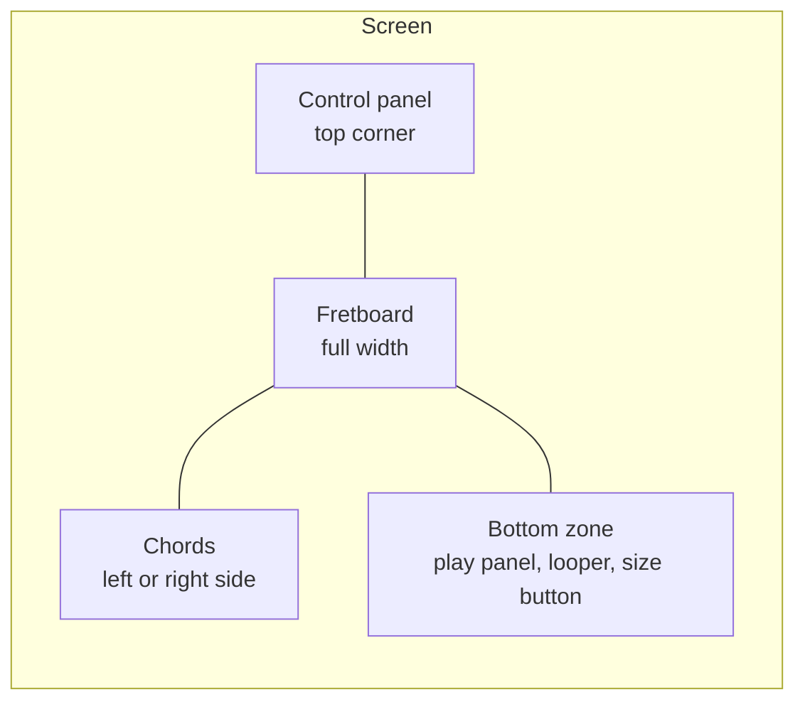

# Features

Each section says what the person can do, which controls they use and where the code sits. The tier in brackets is the lowest tier that gets the feature. With sign-in off, each visitor gets Composer.

## Screen layout

The fretboard fills the screen. Panels float over it at the corners.

- **Chords display mode** in Settings moves the chords to the left or right. The control panel and the bottom zone move to the other side.
- **Dialogs** settings, strumming and the piano roll open as drawers or full dialogs over the fretboard.

## Fretboard

The fretboard shows the notes of the chosen scale and plays a note on tap.

- **Tap a note** it plays with the lead instrument and the marker lights up.
- **Chord shapes** when a chord plays, its notes light up on the neck.
- **Note display mode** shows note names, fret numbers or semitones from the root (`Note_Shift`). Open strings show the note name.
- **Skins** change the look of the neck [Composer].
- **Size** the size button in the bottom zone opens sliders for width and height. A lock keeps the ratio.

Code: [Fretboard.tsx](../src/app/components/fret/Fretboard.tsx), [fretboardLayout.ts](../src/app/components/fret/fretboardLayout.ts), [aspectRatio/](../src/app/components/aspectRatio/).

## Scale, tuning and capo

The control panel sets what the fretboard shows.

- **Style and scale** pick a scale group, then a scale. Groups run from Minor and Major to Gypsy, Blues and Bebop Jazz. `Chromatic (All notes)` sits under Special.
- **Tuning** standard `EBGDAE` by default. The list has standard, drop, celtic, folk, cross and open tunings. Each comes on any root note, for 6, 7 or 8 strings.
- **Root note** the open low string sets the root of the scale. Standard tuning gives E. Another tuning root or a capo changes the key.
- **Capo** moves the root note and the sound up by frets.

A change to scale, tuning or capo stops playback, rebuilds the chords and clears the looper.

Code: [ScaleAndGroupSelector.tsx](../src/app/components/settings/selectors/ScaleAndGroupSelector.tsx), [CapoAndTuningSelector.tsx](../src/app/components/settings/selectors/CapoAndTuningSelector.tsx), [scales.ts](../src/app/data/scales.ts), [tunings.ts](../src/app/data/tunings.ts).

## Chords

The chords panel lists the chords that fit the scale on each note.

- **Tap a chord** it plays once, strummed string by string.
- **Hold a chord** it strums with the chosen pattern until release. See [Strumming](#strumming).
- **Slash chords** extra buttons play the chord over another bass note, such as `C/E`.
- **Basic chord types** major and minor are free. More types such as 7th, sus and dim need Explorer.

Settings that change how a chord sounds:

| Setting | Where | What it does |
| --- | --- | --- |
| **Chord play mode** | Settings | picks the shape: round robin, preferred, fewest or most notes, barre, with thumb, first, random |
| **Notes to play in chord** | Settings | caps how many strings sound |
| **Delay between notes in chord** | Control panel | time between strings in one strum |
| **Show chords for ♯ notes** | Settings | adds chords on sharp roots |
| **Alternate chords (↑↓)** | Settings | flips the strum direction on each press |

Web Workers build the chord shapes when the app starts or the guitar settings change. The rows fill in one chord type at a time as the workers finish.

Code: [chords/](../src/app/components/chords/), [chordModes.ts](../src/app/data/chordModes.ts), [chordPlayer.ts](../src/app/engine/chords/chordPlayer.ts), [chordsGeneratorWorkerApi.ts](../src/app/engine/chords/chordsGeneratorWorkerApi.ts).

## Strumming

A held chord plays a strumming pattern in time with the clock.

- **Pattern** pick one from the list, or build a new one with up strokes, down strokes and rests.
- **Pattern length** each step is a bar, half bar, beat, 1/8, 1/16, 1/32 or 1/64.
- **Wait for pattern to finish** a release lets the pattern play to its end.
- **Chord switching amidst pattern** a new chord takes over the running pattern without a restart.
- **Immediate chord grace period** a short window after the first press. A release inside it plays the chord once and skips the pattern.

Custom patterns stay in `localStorage` under the `strummingPatterns` key.

Code: [strumming/](../src/app/components/strumming/), [useStrumming.ts](../src/app/hooks/useStrumming.ts), [strummingPatterns.ts](../src/app/data/strummingPatterns.ts), [strummingPatternsStorage.ts](../src/app/engine/strummingPatternsStorage.ts).

## Play panel

The play panel plays, steps through and saves what is loaded.

| Button | What it does |
| --- | --- |
| **Play** | plays by playback type. Pressed again during playback, it replays from the start |
| **Pause** | pauses, and a second press goes on from the same spot |
| **Previous, next** | steps one event back or forward |
| **Reset** | after a confirm, stops playback and drops the loaded melody |
| **Download** | saves the loaded melody with its piano roll edits as a Guitar Pro `.gp` file. Hold it for a `.mid` file. Shows once a melody exists |
| **Metronome** | turns the click on and off |
| **Record** | records MIDI [Composer]. See [MIDI recording](#midi-recording) |

Space starts playback from anywhere on the page. The piano roll takes Space for its own player while open.

Playback types, picked in Settings [Explorer]:

- **Melody** plays a random song example written in the current scale, at the song's tempo.
- **Scale** plays the scale string by string, up or down at random. A note the next string repeats plays once.
- **Full string scale** plays each scale note on each string, repeats included.

Without Explorer, Play plays the scale.

Right click or hold Play to pick a song [Explorer]. The menu lists every song sorted by name, and songs in the current scale show in green. A song from another scale switches the scale group, scale and playback type to match, then plays at the song's tempo. Uploaded songs say "uploaded" and have a delete button.

Code: [playPanel/](../src/app/components/playPanel/), [usePlay.ts](../src/app/hooks/usePlay.ts), [midiPlayer.ts](../src/app/engine/midiPlayer.ts), [songLibrary.ts](../src/app/engine/songs/songLibrary.ts), [public/songs/](../public/songs/).

## MIDI recording

[Composer] The record button captures each note and chord the person plays.

- **Start** the button turns red. The metronome starts if "Start metronome when recording" is on.
- **Stop** the recording becomes the melody. The piano roll and the download button pick it up.
- **Cancel** a second button drops the take without saving.
- **Save MIDI file immediately after recording** downloads the `.mid` file on stop.

Notes and chords go to separate tracks, each with its own instrument.

Code: [RecordButton.tsx](../src/app/components/playPanel/RecordButton.tsx), [midiRecorder.ts](../src/app/engine/midiRecorder/midiRecorder.ts), [midiSaver.ts](../src/app/engine/midiRecorder/midiSaver.ts).

## Looper

[Composer] The looper records short loops on channels and plays them together.

- **Channels** 2 at start, from 1 to 8. The plus and minus buttons add or remove the last one.
- **Record** one channel records at a time. Stop, and that channel starts looping straight away.
- **Loop length** whole bars. A stop in the first half of a bar drops that bar.
- **Play and pause** each channel has its own button. Channels stay in time with each other.
- **Save and clear** save mixes the channels into one `.mid` file. Clear empties them.

A change to scale, tuning or capo clears the looper. Each loop also shows up in the piano roll as `Loop 1`, `Loop 2` and on.

Code: [looper/](../src/app/components/looper/), [looper.ts](../src/app/engine/looper/looper.ts), [looperRecorder.ts](../src/app/engine/looper/looperRecorder.ts), [looperPlayer.ts](../src/app/engine/looper/looperPlayer.ts).

## Piano roll

The piano roll edits a track note by note. It opens from the control panel.

- **Track picker** the melody or any looper channel with a recording. An empty melody is ready to draw in.
- **Tools** select, draw and erase. Notes can move, stretch, copy and quantize to the grid.
- **Snap** picks the grid step. "Keep notes in the scale" holds drawn and moved notes on scale notes.
- **Chords** a chord shows as one block. A double click or double tap opens a dialog with the chord types on that root.
- **Transport** play, playhead to start, follow the playhead, undo and redo.

The first note drawn into the empty melody makes that melody the one that plays and downloads. The full key list is in the [root README](../README.md#piano-roll-keys).

Code: [pianoRoll/](../src/app/components/pianoRoll/), [PianoRollProvider.tsx](../src/app/context/PianoRollProvider.tsx), [engine/pianoRoll/](../src/app/engine/pianoRoll/).

## Song upload

[Composer] The upload button adds Guitar Pro and MIDI files to the song list. The browser keeps them.

1. The app reads the file: tab, tempo, instruments and the `Chords` track.
2. The scale detector picks the smallest scale that holds every note. The song goes under that scale.
3. The first file plays at once, moved to the key picked in the settings.

- **Chords** only a track named `Chords` plays chords. The chord name comes from the file, or from the notes when the file has none.
- **Other tracks** play their notes as written, with no chord guessing.
- **Delete** hold Play and press the bin next to an uploaded song.
- **Download** hold Play and press the download icon next to any song. The `.gp` file is in the key and tuning from the settings.
- **Edits** a piano roll edit saves a second after the last change. An uploaded song updates. A built-in song gets an own copy under the same name, and the built-in file stays as it was.

Code: [SongUploadButton.tsx](../src/app/components/settings/buttons/SongUploadButton.tsx), [DownloadButton.tsx](../src/app/components/playPanel/DownloadButton.tsx), [songs/](../src/app/engine/songs/).

## Chord and scale detection

[Explorer] Two buttons in the control panel name what the person taps. One runs at a time.

- **Detect chord** tap at least 3 notes on different strings. A message lists the matching chords. A second tap on a marked note removes it.
- **Detect scale** switches to the chromatic scale. Tap at least 5 different notes, then a dialog suggests scales to switch to.

Code: [DetectChordButton.tsx](../src/app/components/settings/buttons/DetectChordButton.tsx), [DetectScaleButton.tsx](../src/app/components/settings/buttons/DetectScaleButton.tsx), [chordDetectorBuilder.ts](../src/app/engine/chords/chordDetectorBuilder.ts), [scaleDetectorBuilder.ts](../src/app/engine/scales/scaleDetectorBuilder.ts), [ScaleDetectionDialog](../src/app/components/alert/).

## Settings

The gear button opens a drawer. Each value survives a reload.

| Group | Settings |
| --- | --- |
| **Look** | theme (light, dark, match OS), note display mode, chords display mode, skin [Composer] |
| **Chords** | chord play mode, notes to play in chord, ♯ chords, alternate chords |
| **Sound** | lead instrument and chord instrument [Explorer], playback volume, metronome volume, reverb [Explorer, desktop only] |
| **Playback** | playback type [Explorer] |
| **Recording** | start metronome when recording, save MIDI right after recording [Composer] |

"Reset settings" at the bottom puts the defaults back.

The control panel holds the settings people change while playing: scale, tuning, capo, volume, metronome volume, tempo and chord strum delay. It also has fullscreen (desktop), about, strumming, piano roll, detection and upload buttons.

Code: [SettingsView.tsx](../src/app/components/settings/SettingsView.tsx), [ControlPanel.tsx](../src/app/components/settings/ControlPanel.tsx), [settingsSlice.ts](../src/app/store/settingsSlice.ts), [uiSlice.ts](../src/app/store/uiSlice.ts).

## Instruments and sound

[Explorer] The lead and chord instruments are picked apart.

- **Groups** General MIDI families: guitar, piano, bass, ethnic, brass, synth and more. Sound effects such as applause are in too.
- **Loading** soundfonts download on the first tap or key press. Each loaded instrument stays in memory.
- **Reverb** desktop only. On phones the effect stutters, so the app skips it.
- **iPhone** the app sets the audio session to playback, so sound plays with the silent switch on.

Code: [instruments.ts](../src/app/data/instruments.ts), [soundHelper.ts](../src/app/engine/sound/soundHelper.ts).

## Sign-in and paid tiers

With sign-in on, a sign-in panel shows on the page.

- **Patreon** sign in with Patreon. The server reads the Patreon membership and maps it to Explorer or Composer.
- **Google Play** in the Android app, a purchase goes through the Digital Goods API. The person can later change or cancel the plan from the same panel.
- **Locked buttons** record, detect chord, detect scale and song upload show greyed out. A tap says which plan unlocks them.
- **Hidden controls** the looper, instrument pickers, skin, playback type and reverb stay hidden until the tier allows them.

Code: [auth/](../src/app/components/auth/), [premiumFeatures.ts](../src/lib/premiumFeatures.ts), [tierHelper.ts](../src/lib/tierHelper.ts), [NoPremiumButton.tsx](../src/app/components/settings/buttons/NoPremiumButton.tsx).

## Install and offline

The app is a PWA. It installs to the home screen and opens fullscreen in landscape.

- **Service worker** asks the network first and keeps a copy of each good response. Offline, it serves the copy.
- **Android** the Play Store app wraps the same PWA.

Code: [sw.js](../public/sw.js), [manifest.json](../public/manifest.json).
