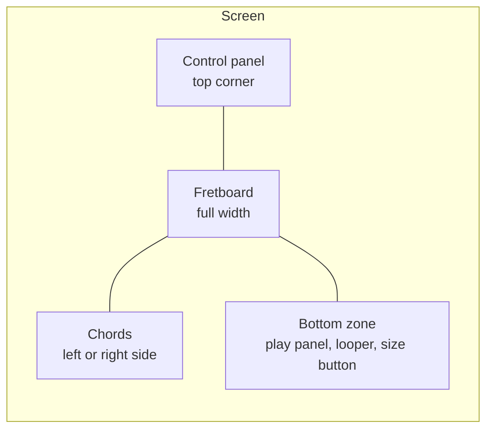

# Features

Each section says what the person can do, which controls they use and where the code sits. The tier in brackets is the lowest tier that gets the feature. With sign-in off, each visitor gets Composer.

## Screen layout

The fretboard fills the screen. Panels float over it at the corners.

- **Chords display mode** in Settings moves the chords to the left or right. The control panel and the bottom bar buttons move to the other side. The chords sit next to the bottom bar while both fit in one row. Otherwise the chords sit above the bar.
- **Dialogs** settings, strumming and the piano roll open as drawers or full dialogs over the fretboard.

## Fretboard

The fretboard shows the notes of the chosen scale and plays a note on tap.

- **Tap a note** it plays with the lead instrument and the marker lights up.
- **Chord shapes** when a chord plays, its notes light up on the neck.
- **Note display mode** shows note names, fret numbers or semitones from the root (`Note_Shift`). Open strings show the note name.
- **Skins** change the look of the neck [Composer].
- **Size** the size button in the bottom zone opens sliders for width and height. A lock keeps the ratio.
- **Pinch** two fingers on the neck change its size: a sideways pinch sets the width, an up and down pinch sets the height. Fingers that barely move still play a chord. On a trackpad, pinch or hold Ctrl and scroll.

Code: [Fretboard.tsx](../src/app/components/fret/Fretboard.tsx), [fretboardLayout.ts](../src/app/components/fret/fretboardLayout.ts), [useFretboardPinchZoom.ts](../src/app/components/fret/useFretboardPinchZoom.ts), [aspectRatio/](../src/app/components/aspectRatio/).

## Scale, tuning and capo

The key button at the start of the control panel says what the fretboard shows, such as "E Minor" over "Aeolian / Natural · E standard". A press opens the pickers.

- **Style and scale** pick a scale group, then a scale. Groups run from Minor and Major to Gypsy, Blues and Bebop Jazz. `Chromatic (All notes)` sits under Special.
- **Tuning** standard `EBGDAE` by default. The list has standard, drop, celtic, folk, cross and open tunings. Each comes on any root note, for 6, 7 or 8 strings.
- **Root note** the open low string sets the root of the scale. Standard tuning gives E. Another tuning root or a capo changes the key.
- **Capo** "No capo" or a fret, such as "Fret 3 (G)". The note in brackets is the new root. The key button shows "Capo 3" while it is on.

A change to scale, tuning or capo stops playback, rebuilds the chords and clears the looper.

Code: [KeyChip.tsx](../src/app/components/settings/KeyChip.tsx), [keyDescription.ts](../src/app/helpers/keyDescription.ts), [selectors/](../src/app/components/settings/selectors/), [scales.ts](../src/app/data/scales.ts), [tunings.ts](../src/app/data/tunings.ts).

## Chords

The chords panel opens on the chords of the key: one chord per scale note, from the root up. Each is the first chord type that fits the scale, such as `Em F#dim G Am Bm C D` for E minor. The chords fill a grid as close to a square as they allow, row by row. Empty cells in the last row get a seventh chord on the root, then on the fifth, such as `Em7 Bm7`. Seventh chords need Explorer.

- **All** in the panel header opens the full grid: every root note against every chord type. Chords outside the scale show grey. **In key** goes back.
- **Tap a chord** it plays once, strummed string by string.
- **Hold a chord** it strums with the chosen pattern until release. See [Strumming](#strumming).
- **Two fingers** put down together scroll the grid on a touch screen. The first finger's chord sounds once and stops. A second finger added later plays its chord as usual.
- **Slash chords** the `Bass note` strip in the full grid plays every chord over another bass note, and the buttons read `C/E`. The bass goes where the hand reaches it. Chord notes at or under the bass drop out. Notes outside the scale show grey. The key view shows the strip only while a bass note is on.
- **Basic chord types** major and minor are free. More types such as 7th, sus and dim need Explorer.

Settings that change how a chord sounds:

| Setting                          | Where     | What it does                                                                                    |
| -------------------------------- | --------- | ----------------------------------------------------------------------------------------------- |
| **Chord play mode**              | Settings  | picks the shape: round robin, preferred, fewest or most notes, barre, with thumb, first, random |
| **Notes to play in chord**       | Settings  | caps how many strings sound                                                                     |
| **Delay between notes in chord** | Strumming | time between strings in one strum                                                               |
| **Show chords for ♯ notes**      | Settings  | adds chords on sharp roots to the full grid                                                     |
| **Alternate chords (↑↓)**        | Settings  | flips the strum direction on each press                                                         |

Web Workers build the chord shapes when the app starts or the guitar settings change. The rows fill in one chord type at a time as the workers finish.

Code: [chords/](../src/app/components/chords/), [chordModes.ts](../src/app/data/chordModes.ts), [chordPlayer.ts](../src/app/engine/chords/chordPlayer.ts), [chordsGeneratorWorkerApi.ts](../src/app/engine/chords/chordsGeneratorWorkerApi.ts).

## Strumming

A held chord plays a strumming pattern in time with the clock.

- **Pattern** the arrows button in the control panel lists the patterns. A tap picks one. You can also build a new one with up strokes, down strokes and rests.
- **Pattern length** each step is a bar, half bar, beat, 1/8, 1/16, 1/32 or 1/64.
- **Wait for pattern to finish** a release lets the pattern play to its end.
- **Chord switching amidst pattern** a new chord takes over the running pattern without a restart.
- **Delay between notes in chord** the time between strings in one strum, from 0 ms.
- **Immediate chord grace period** a short window after the first press. A release inside it plays the chord once and skips the pattern.

Custom patterns stay in `localStorage` under the `strummingPatterns` key.

Code: [strumming/](../src/app/components/strumming/), [useStrumming.ts](../src/app/hooks/useStrumming.ts), [strummingPatterns.ts](../src/app/data/strummingPatterns.ts), [strummingPatternsStorage.ts](../src/app/engine/strummingPatternsStorage.ts).

## Play panel

The play panel plays, steps through and saves what is loaded.

| Button             | What it does                                                                                                                        |
| ------------------ | ----------------------------------------------------------------------------------------------------------------------------------- |
| **Play**           | plays by playback type. Pressed again during playback, it replays from the start                                                    |
| **Pause**          | pauses, and a second press goes on from the same spot                                                                               |
| **Previous, next** | steps one event back or forward                                                                                                     |
| **Download**       | saves the loaded melody with its piano roll edits as a Guitar Pro `.gp` file. Hold it for a `.mid` file. Shows once a melody exists |
| **Metronome**      | turns the click on and off                                                                                                          |
| **Record**         | records MIDI [Composer]. Hold it to pick a new song or a new track. See [MIDI recording](#midi-recording)                           |
| **Auto quantize**  | puts recorded and looped notes on the quantize grid [Composer]. Hold it to pick the length. See [Quantize](#quantize)               |
| **Tempo**          | shows the BPM. A press opens a slider. Hidden while the piano roll is open                                                          |
| **Volume**         | shows the playback volume. A press opens a slider. Hidden while the piano roll is open                                              |

Space starts playback from anywhere on the page. The piano roll takes Space for its own player while open.

The song plate at the top shows the loaded song from the song list.

- **Name** a click renames an uploaded or recorded song. Enter saves, Escape cancels.
- **Close** the cross stops playback and unloads the song. The song stays in the list.
- **Play** with a song loaded and stopped, Play plays that song again.
- **Recording** the plate turns red with a timer, and says whether the take makes a new song or a new track.

Playback types, picked in Settings [Explorer]:

- **Melody** plays a random song example written in the current scale, at the song's tempo.
- **Scale** plays the scale string by string, up or down at random. A note the next string repeats plays once.
- **Full string scale** plays each scale note on each string, repeats included.

Without Explorer, Play plays the scale.

Right click or hold Play to pick a song [Explorer]. The menu lists every song sorted by name, and songs in the current scale show in green. Your songs (uploaded, recorded, drawn or edited) come first under "Your songs" with a person icon. Built-in songs follow under "Built-in songs" with a music icon. The search field stays at the top of the menu while it scrolls. It keeps songs whose name or scale holds every typed word. A song from another scale switches the scale group, scale and playback type to match, then plays at the song's tempo. Only your songs have a delete button.

Code: [playPanel/](../src/app/components/playPanel/), [usePlay.ts](../src/app/hooks/usePlay.ts), [midiPlayer.ts](../src/app/engine/midiPlayer.ts), [songLibrary.ts](../src/app/engine/songs/songLibrary.ts), [public/songs/](../public/songs/).

## MIDI recording

[Composer] The record button captures the notes and chords the person plays. Notes the app plays back stay out of the take.

Hold the button, or right click it, to pick where the take goes. The pick starts a recording and stays for the next press.

- **A new song** the take goes to the song list as "Recording" with the date and time. It loads as the current song.
- **A new track in this song** the loaded song plays from the playhead and the take lines up with it. The take lands in new tracks named "Take 1" and on, one for notes and one for chords. Recording stops when the song ends. A `+` on the button shows this mode.
- **Stop** saves the take. A take with no notes isn't saved.
- **Cancel** a second button drops the take. A take longer than 3 seconds asks first.
- **Save MIDI file immediately after recording** downloads the `.mid` file on stop.

Without a loaded song, a press records a new song. Undo in the piano roll takes a new track out again.

Code: [RecordButton.tsx](../src/app/components/playPanel/RecordButton.tsx), [NowPlaying.tsx](../src/app/components/playPanel/NowPlaying.tsx), [recordedTracks.ts](../src/app/engine/pianoRoll/recordedTracks.ts), [midiRecorder.ts](../src/app/engine/midiRecorder/midiRecorder.ts), [midiSaver.ts](../src/app/engine/midiRecorder/midiSaver.ts).

## Looper

[Composer] The looper records short loops on channels and plays them together.

- **Channels** 2 at start, from 1 to 8. The plus and minus buttons add or remove the last one.
- **Record** one channel records at a time. Stop, and that channel starts looping straight away.
- **Loop length** whole bars. A stop in the first half of a bar drops that bar.
- **Play and pause** each channel has its own button. Channels stay in time with each other.
- **Save as song** puts the loops in the song list as "Loops" with the date and time, and loads that song. A second song in the same minute gets a number after the time. Each channel gets a track, "Loop 1" and on, and its chords get one more. A channel repeats until every loop ends together, up to 32 bars. Past that the song stops at the longest loop.
- **Update** after the first save, the same button saves the loops into that song again. A deleted song comes back as a new one.
- **MIDI** hold the save button to download the channels mixed into one `.mid` file.
- **Clear** empties the channels. The saved song stays in the list, and the next save makes a new song.

A change to scale, tuning or capo clears the looper. Loops recorded since the last save go to the song list first, written in the old key and tuning, and a message names the song. Each loop also shows up in the piano roll as `Loop 1`, `Loop 2` and on.

Code: [looper/](../src/app/components/looper/), [looper.ts](../src/app/engine/looper/looper.ts), [looperSong.ts](../src/app/engine/looper/looperSong.ts), [looperRecorder.ts](../src/app/engine/looper/looperRecorder.ts), [looperPlayer.ts](../src/app/engine/looper/looperPlayer.ts).

## Quantize

One quantize length, from 1/1 to 1/64, serves the piano roll, the recording and the looper. It works like Cubase: 1/16 at start.

- **Auto quantize** the button next to Record. On, it moves each recorded or looped note to the nearest quantize line as it comes in. The note still sounds when played.
- **Pick the length** hold the Auto quantize button, or use the `Q` list in the piano roll. Picking from the button turns Auto quantize on.
- **Loop end** a looped note that lands on the line where the loop ends moves to the loop start.
- **Piano roll** the Q button and the `Q` key move the selected notes, or every note, onto the quantize grid. The grid for drawing stays separate.

Code: [quantize/](../src/app/components/quantize/), [recordQuantize.ts](../src/app/engine/recordQuantize.ts).

## Piano roll

The piano roll edits a track note by note. It opens from the control panel.

- **Narrow screen** one row keeps the track picker, play, undo and the tools. The `⋯` button opens the rest.
- **Track picker** the melody or any looper channel with a recording. An empty melody is ready to draw in.
- **Song tracks** a song with several tracks, such as 2 guitars and vocals, shows each track in its own colour. Picking one track edits only its notes. The other tracks stay in view at low opacity. A click on one of their notes picks that note's track. New and pasted notes go into the picked track. `T` steps through the tracks.
- **Track edits** buttons next to the track picker add an empty track, rename the picked track and delete it. Undo brings back the notes of a deleted track. A new name goes into the saved song.
- **Solo** the headphones button plays only the picked track. With all tracks picked every track plays. `S` turns it on and off. Closing the piano roll lets every track play again.
- **Note volume** a slider sets the volume (MIDI velocity) of the selected notes. A quieter note shows paler. The volume plays back, goes into MIDI downloads and into Guitar Pro files as dynamics, from ppp to f.
- **Tools** select, draw and erase. Notes can move, stretch, copy and quantize. See [Quantize](#quantize).
- **Empty bars** a delete that empties the first bars of a song moves every track left, so the song starts in bar 1. The song ends with its last note. Loops keep their length.
- **Transpose** arrow buttons move the selected notes a step or an octave up or down. With nothing selected they move every note of the picked track.
- **Snap** picks the grid step. "Keep notes in the scale" holds drawn and moved notes on scale notes. A scale with all 12 notes turns the button off.
- **Chords** a chord shows as one block. A double click or double tap opens a dialog with the chord types on that root.
- **Transport** play, playhead to start, follow the playhead, undo and redo. The view stops following while notes are selected.
- **Loop a range** a drag along the ruler loops the melody between the two points and starts it right away. A click on the ruler outside the range drops the loop.

The first note drawn into the empty melody makes that melody the one that plays and downloads. It also goes to the song list as "Melody" with the date and time. The full key list is in the [root README](../README.md#piano-roll-keys).

Code: [pianoRoll/](../src/app/components/pianoRoll/), [PianoRollProvider.tsx](../src/app/context/PianoRollProvider.tsx), [engine/pianoRoll/](../src/app/engine/pianoRoll/).

## Song upload

[Composer] The upload button adds Guitar Pro and MIDI files to the song list. The browser keeps them.

1. The app reads the file: tab, tempo, instruments and the `Chords` track.
2. The scale detector picks the smallest scale that holds every note. The song goes under that scale.
3. The first file plays at once, moved to the key picked in the settings.

- **Chords** only a track named `Chords` plays chords. The chord name comes from the file, or from the notes when the file has none.
- **Other tracks** play their notes as written, with no chord guessing.
- **Delete** open the song list and press the bin next to one of your songs. Built-in songs have no bin.
- **Download** hold Play and press the download icon next to any song. The `.gp` file is in the key and tuning from the settings.
- **Edits** a piano roll edit saves a second after the last change. An uploaded song updates. A built-in song gets an own copy under the same name, and the built-in file stays as it was.

### Add a song from Songsterr

[Composer] The cloud button next to upload opens a dialog. It turns a Songsterr song into a Guitar Pro file and adds it to your songs. The song list opens the same dialog from "Add from Songsterr", with the list search already typed in.

1. Type a band or a song. The list fills in once typing stops. Pick a song from it.
2. Pick the melody track and the bass track. The bass picks the chords. "None" takes the chords from the lowest melody notes.
3. Tick more tracks, such as a second guitar, vocals or a flute. Every track except drums starts ticked.
4. Press Add. The whole song goes in. It moves to an E tonic and its notes move into the scale that fits best, as in `pnpm songsterr`.

- **Bars** the dialog takes every bar. Cut the extra ones in the piano roll.
- **Drums** the app plays no drums, so the lists leave drum tracks out. When the most popular track is drums, the first other track becomes the melody.
- **One role per track** a Songsterr track goes in once. The melody list greys out the bass track, the bass list greys out the melody, and "More tracks" leaves both out.
- **Instruments** each extra track plays with its Songsterr instrument. Its notes move into the scale with the melody.
- **Server** Songsterr allows no browser requests, so search and song details go through `/api/songsterr`. The GitHub Pages copy has no API routes, so it calls `/api/songsterr` on `guitar-upscale.vercel.app`. Those routes allow requests from `oleg-chibikov.github.io` ([cors.ts](../src/lib/cors.ts)).

Code: [SongUploadButton.tsx](../src/app/components/settings/buttons/SongUploadButton.tsx), [SongsterrImportDialog.tsx](../src/app/components/settings/buttons/SongsterrImportDialog.tsx), [SongListButton.tsx](../src/app/components/playPanel/SongListButton.tsx), [DownloadButton.tsx](../src/app/components/playPanel/DownloadButton.tsx), [songs/](../src/app/engine/songs/).

## Chord and scale detection

[Explorer] Detect chord sits in the control panel. Detect scale sits behind the key button. One runs at a time.

- **Detect chord** tap at least 3 notes on different strings. A message lists the matching chords. A second tap on a marked note removes it.
- **Detect scale** switches to the chromatic scale and closes the pickers. The key button turns red and says "Detecting scale". Tap at least 5 different notes, then a dialog suggests scales to switch to.

Code: [DetectChordButton.tsx](../src/app/components/settings/buttons/DetectChordButton.tsx), [DetectScaleButton.tsx](../src/app/components/settings/buttons/DetectScaleButton.tsx), [chordDetectorBuilder.ts](../src/app/engine/chords/chordDetectorBuilder.ts), [scaleDetectorBuilder.ts](../src/app/engine/scales/scaleDetectorBuilder.ts), [ScaleDetectionDialog](../src/app/components/alert/).

## Settings

The gear button opens a drawer. Each value survives a reload.

| Group         | Settings                                                                                                                 |
| ------------- | ------------------------------------------------------------------------------------------------------------------------ |
| **Look**      | theme (dark, light, match system: follows the OS as it changes), note display mode, chords display mode, skin [Composer] |
| **Chords**    | chord play mode, notes to play in chord, ♯ chords, alternate chords                                                      |
| **Sound**     | lead instrument and chord instrument [Explorer], playback volume, metronome volume, reverb [Explorer, desktop only]      |
| **Playback**  | playback type [Explorer]                                                                                                 |
| **Recording** | start metronome when recording, save MIDI right after recording [Composer]                                               |

"Reset settings" at the bottom puts the defaults back.

The control panel opens with the key button: scale, tuning, capo and scale detection. Next come the settings, piano roll, strumming, detect chord, upload, fullscreen (desktop), reload page and about buttons. The arrow at the end hides everything but the key button. Tempo and volume sit in the play panel.

On a phone held upright, a tip asks to turn the phone sideways. The neck doesn't fit otherwise. A narrow control panel scrolls sideways.

Code: [SettingsView.tsx](../src/app/components/settings/SettingsView.tsx), [ControlPanel.tsx](../src/app/components/settings/ControlPanel.tsx), [settingsSlice.ts](../src/app/store/settingsSlice.ts), [uiSlice.ts](../src/app/store/uiSlice.ts).

## Instruments and sound

[Explorer] The lead and chord instruments are picked apart.

- **Groups** General MIDI families: guitar, piano, bass, ethnic, brass, synth and more. Sound effects such as applause are in too.
- **Loading** soundfonts download on the first tap or key press. Each loaded instrument stays in memory.
- **Reverb** desktop only. On phones the effect stutters, so the app skips it.
- **iPhone** the app sets the audio session to playback, so sound plays with the silent switch on.

Code: [instruments.ts](../src/app/data/instruments.ts), [soundHelper.ts](../src/app/engine/sound/soundHelper.ts).

## Sign-in and paid tiers

With sign-in on, a sign-in panel shows on the page.

- **Patreon** sign in with Patreon. The server reads the Patreon membership and maps it to Explorer or Composer.
- **Google Play** in the Android app, a purchase goes through the Digital Goods API. The person can later change or cancel the plan from the same panel.
- **Locked buttons** record, detect chord, detect scale and song upload show greyed out. A tap says which plan unlocks them.
- **Hidden controls** the looper, instrument pickers, skin, playback type and reverb stay hidden until the tier allows them.

Code: [auth/](../src/app/components/auth/), [premiumFeatures.ts](../src/lib/premiumFeatures.ts), [tierHelper.ts](../src/lib/tierHelper.ts), [NoPremiumButton.tsx](../src/app/components/settings/buttons/NoPremiumButton.tsx).

## Install and offline

The app is a PWA. It installs to the home screen and opens fullscreen in landscape.

- **Service worker** asks the network first and keeps a copy of each good response. Offline, it serves the copy.
- **Android** the Play Store app wraps the same PWA.

Code: [sw.js](../public/sw.js), [manifest.json](../public/manifest.json).
