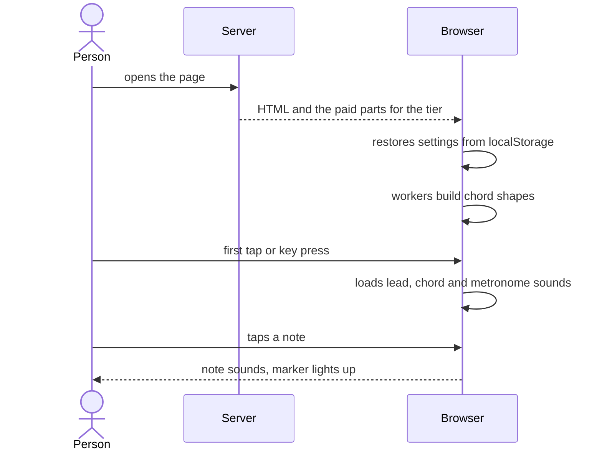
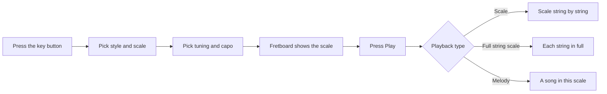
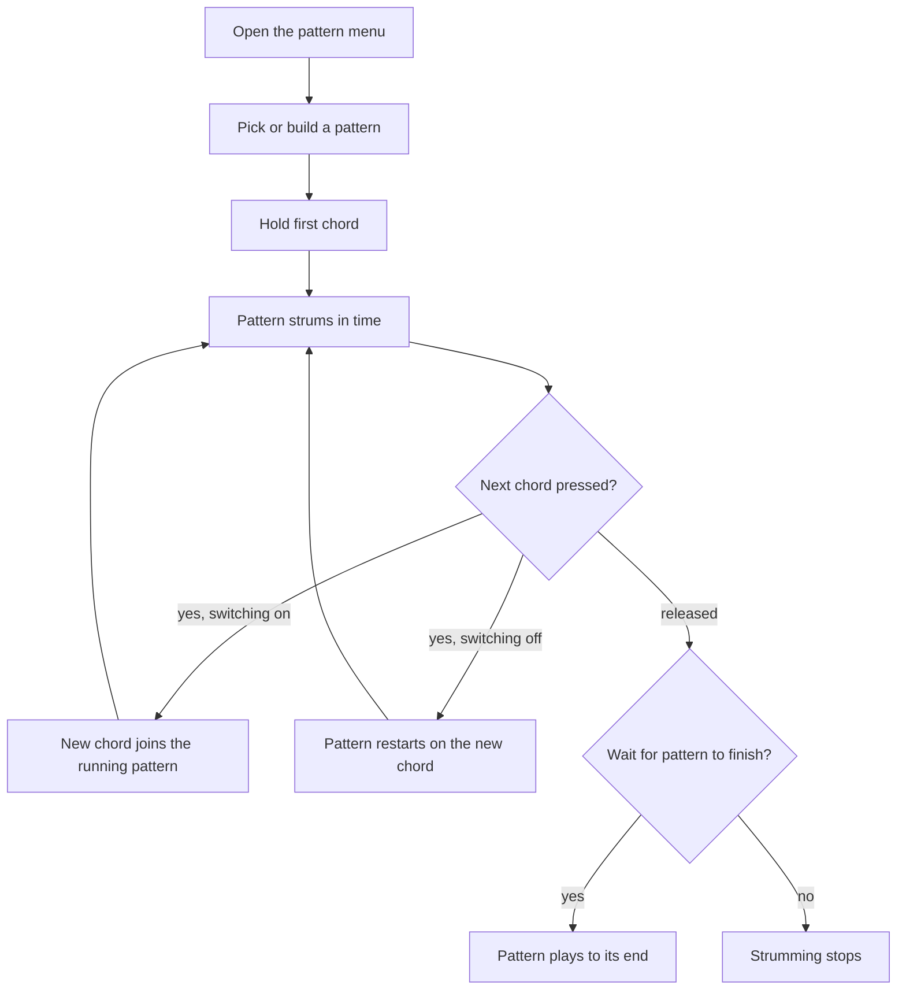
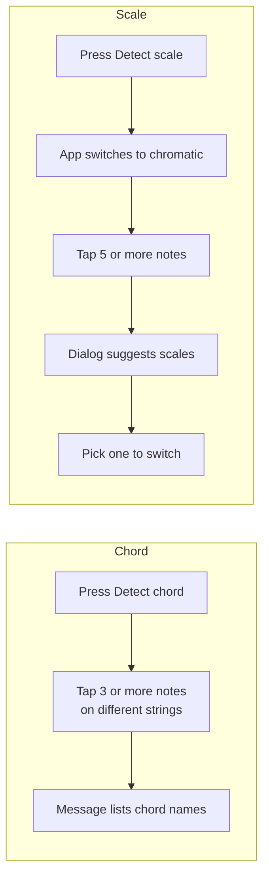
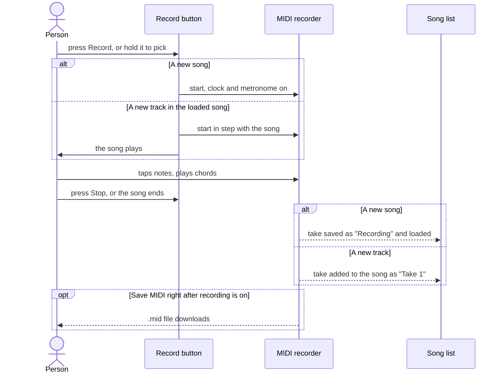
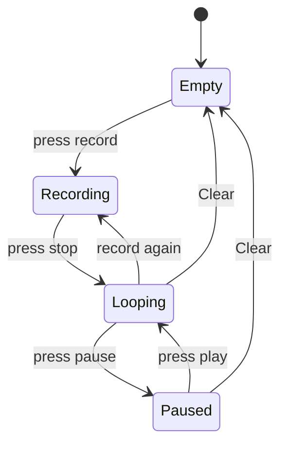
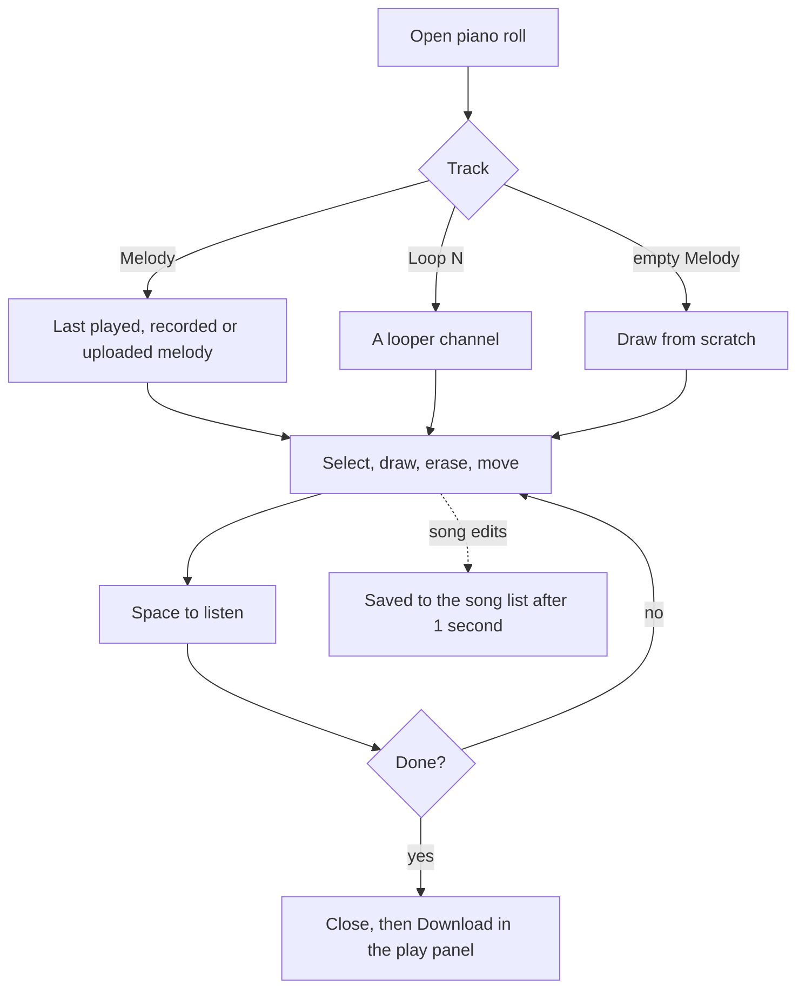
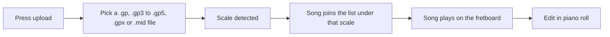
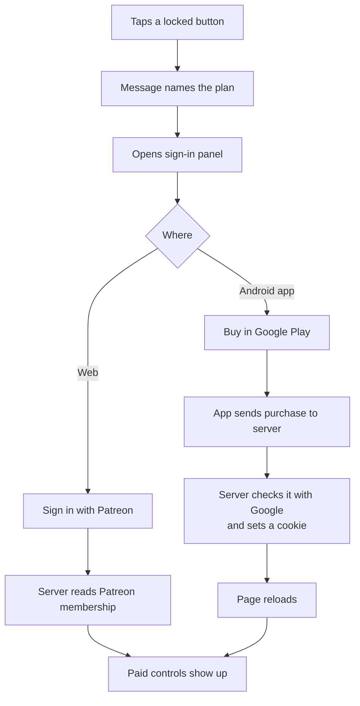

# User flows

Each flow follows one person through one task. The steps name the buttons as the screen shows them. [features.md](features.md) explains each control.

## First visit

The page opens with the fretboard in E natural minor, standard tuning and 120 BPM. Sound loads on the first touch.

1. The fretboard shows the scale notes. The chords fill in a row at a time.
2. The first tap anywhere loads the sounds. It takes a moment on a slow network.
3. From the second tap, notes play straight away.

## Learn a scale

1. Press the key button at the start of the control panel, such as "E Minor". Pick a style, then a scale.
2. Set the tuning and capo. The scale root is the open low string, so these two set the key.
3. Press Play, or Space, to hear the scale.
4. With Explorer, set "Playback type" to Melody in Settings. Play then picks a song written in the scale and sets its tempo.
5. Tap along on the fretboard. Note names or fret numbers come from "Note display mode".

## Strum a chord progression

1. Press the arrows button in the control panel and tap a pattern. "Edit patterns" at the bottom adds and edits custom ones.
2. Set the tempo in the play panel. Turn on the metronome next to it to hear the beat.
3. Hold a chord button. The chord sounds at once, and the pattern goes on in time with the clock.
4. Press the next chord while still holding, or right after release.
5. A quick tap plays the chord once and skips the pattern.

## Find a chord or a scale by ear

[Explorer]

1. Press "Detect chord" in the control panel. For a scale, press the key button, then "Detect scale". Only one runs at a time.
2. Tap the notes heard in the song. A second tap on a marked note removes it.
3. Read the result, then press the button again to stop.

## Record a melody and download it

[Composer]

1. Turn on "Start metronome when recording" in Settings for a click track.
2. Hold Record and pick "A new song", or load a song and pick "A new track in this song".
3. Play. The plate at the top turns red and counts the time.
4. Press Stop. The cross next to it drops the take instead.
5. Press Play to hear it. Click the name on the plate to rename it, or press Download for a `.gp` file.

## Build a song with the looper

[Composer]

1. Press record on channel 1 and play a chord part. Press stop. The channel loops at once.
2. Press record on channel 2 and play a melody over the loop. Press stop.
3. Add channels with the plus button, up to 8.
4. Pause and play channels to arrange the parts.
5. Press save to put the loops in the song list as a song. Press it again later to update that song. Hold it for a `.mid` file.
6. The saved song loads. Hold Record and pick "A new track in this song" to play a solo over it.

A change to scale, tuning or capo clears the looper. Unsaved loops go to the song list first.

## Edit notes in the piano roll

1. Open the piano roll from the control panel.
2. Pick the track: the melody or a loop.
3. Edit with the toolbar or the keys in the [root README](../README.md#piano-roll-keys). Double click a chord to change its type.
4. Press Space to play the track. A loop plays in time with the looper.
5. Close the dialog and press Download to save the melody as `.gp`. Hold Download for `.mid`.

Edits to a song save on their own. An uploaded song updates in place. A built-in song gets its own copy under the same name.

## Add your own song

[Composer]

1. Wait for the chords to finish loading. The upload button stays disabled until then.
2. Press upload and pick a Guitar Pro or MIDI file. A track named `Chords` plays as chords.
3. Watch the file play on the fretboard, then open the piano roll to edit it.
4. Later, right click or hold Play to pick the song again. The bin icon deletes it.

## Download a song as Guitar Pro

[Explorer]

1. Set the key and tuning in the control panel.
2. Right click or hold Play to open the song list. Type in the search field to find the song.
3. Press the download icon next to a song. The `.gp` file is in the key and tuning from the settings, with saved edits.

## Get a paid tier

Sign-in has to be on for this flow.

1. A locked button, such as Record, says which plan unlocks it.
2. On the web, sign in with Patreon. A Patreon member of the Explorer or Composer tier gets it on the next page load.
3. In the Android app, pick a plan in the purchase dialog. Google Play takes the payment.
4. The page reloads with the new tier.
5. Change or cancel the Google Play plan from the same panel. A cancelled plan works until its end date.
